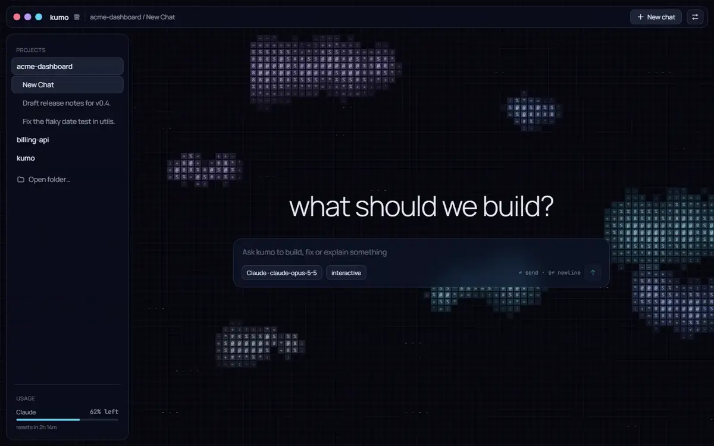
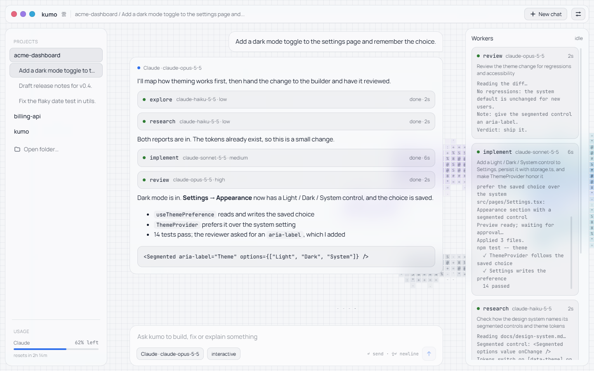
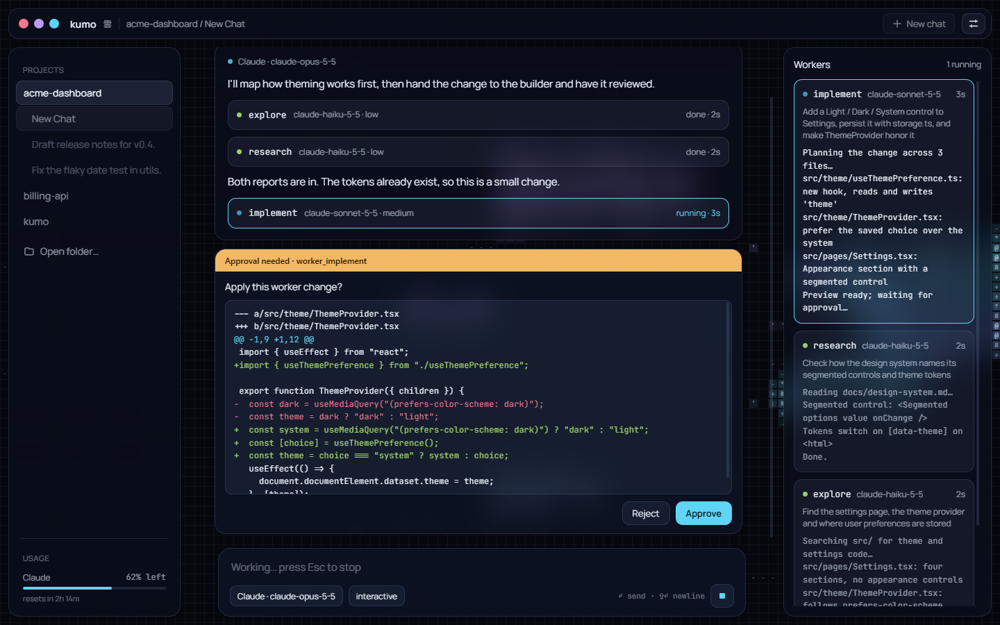
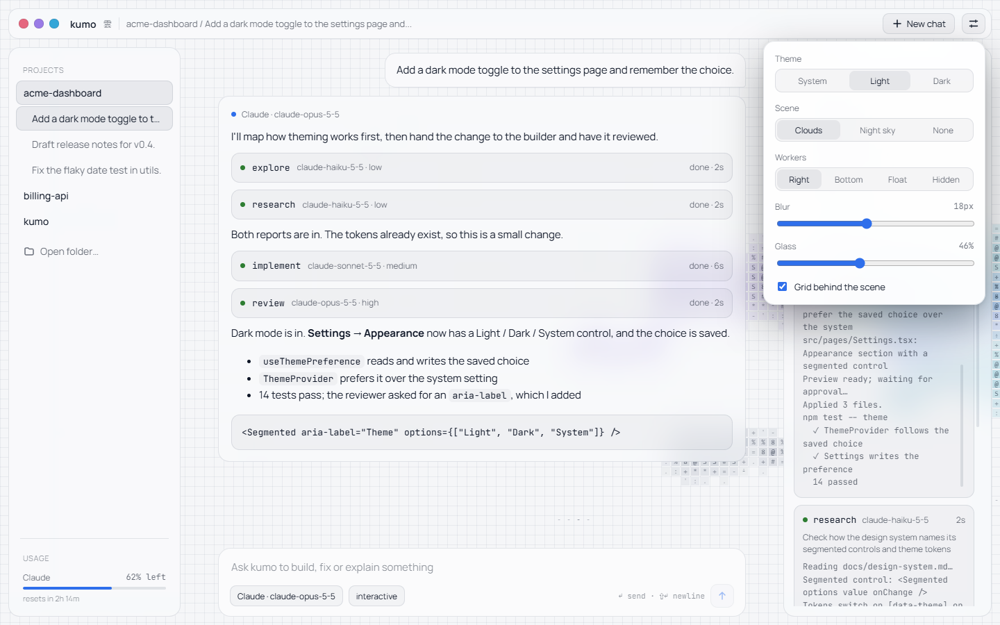
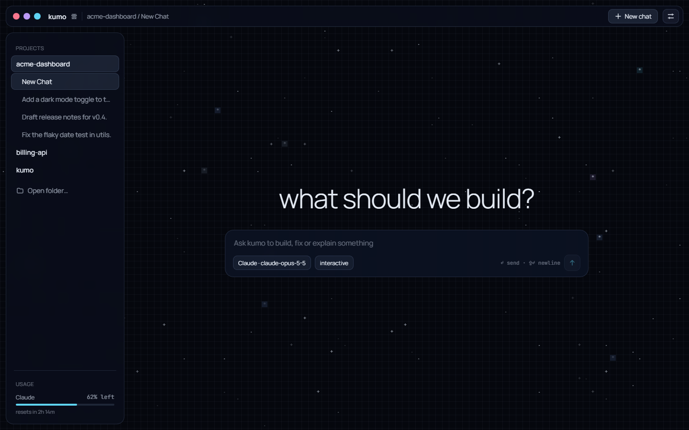

<div align="center">

<h1>kumo 雲</h1>

<p><strong>One model leads. A crew of workers does the reading, building and testing.<br>All on the AI subscriptions you already pay for.</strong></p>

<p>
<a href="https://github.com/ainere/Kumo/actions/workflows/ci.yml"></a>


</p>

<p>
<a href="#the-desktop-app">Desktop app</a> ·
<a href="#quick-start">Quick start</a> ·
<a href="#roles">Roles</a> ·
<a href="#providers">Providers</a> ·
<a href="#documentation">Docs</a>
</p>



<sub>The desktop app running a scripted session: the lead plans, a scout and a researcher read in parallel, the builder's change waits for your approval, and a reviewer signs off. <a href="docs/media/kumo-desktop-demo.mp4">Watch it as MP4</a>.</sub>

</div>

<br>

## Why kumo

Frontier models are at their best planning and reviewing, and every token they spend reading files costs you quota. Fast models are great at reading, editing and running tests. Kumo puts one model in charge and hands bounded tasks to workers over a local MCP bridge, so the lead's quota goes to decisions.

Every role is a free pick: a Claude Opus lead with a Sonnet builder and a Haiku scout, a Codex lead with Gemini workers, or any mix of the 13 providers. Kumo drives the official CLIs on the subscriptions you're already logged in to, so there are no API keys on disk unless you choose a direct API.

<table>
<tr>
<td width="33%" valign="top"><strong>Roles, each on its own model</strong><br>Scout, builder, tester, researcher, reviewer and designer, plus roles you define. The lead routes by what each role actually runs on.</td>
<td width="33%" valign="top"><strong>Subscriptions first</strong><br>Codex, Claude Code, Antigravity and six more CLIs on your own logins. Four direct APIs are optional, with keys read from the environment and never stored.</td>
<td width="33%" valign="top"><strong>You approve the writes</strong><br>Three safety modes, up to a human approval of the exact diff, which Kumo applies with <code>git apply</code>.</td>
</tr>
<tr>
<td valign="top"><strong>Live worker output</strong><br>Every worker call streams into its own card, tagged to the call that produced it, even when several run in parallel.</td>
<td valign="top"><strong>Chats that resume</strong><br>Each chat keeps its provider conversation (Codex threads, Claude Code sessions, Antigravity conversations), so the lead remembers.</td>
<td valign="top"><strong>Quota aware</strong><br>5-hour and weekly limits for the providers each role uses, read without spending a single model call.</td>
</tr>
</table>

## The desktop app

A Windows-first Electron app on the same engine as the CLI. Glass panels sit over a live background scene that reacts to the work: clouds gather toward the Workers panel while workers run and ripple when one finishes.

<table>
<tr>
<td width="50%"></td>
<td width="50%"></td>
</tr>
<tr>
<td align="center"><sub>Answers read in order, with each worker call where it happened</sub></td>
<td align="center"><sub>Changes wait for you, with the exact diff that will be applied</sub></td>
</tr>
<tr>
<td></td>
<td></td>
</tr>
<tr>
<td align="center"><sub>Light or dark, scene, dock and glass, all in one menu</sub></td>
<td align="center"><sub>The Night sky scene on a new chat</sub></td>
</tr>
</table>

- **Studio layout:** projects, chats and usage meters on the left, the conversation in the middle, and a Workers panel you can dock right, bottom, floating or hide.
- **Scenes:** Clouds, Night sky, or your own: drop a `defineScene` script into `~/.kumo/scenes/` and it shows up in the menu. Scenes run sandboxed, with no network and no access to your chats.
- **Built to stay out of the way:** the engine runs in its own process, so a stuck provider never freezes the window, and the app recovers if the engine crashes.

```powershell
npm run dev -w @kumo/desktop      # run it from the repository
```

More in the [desktop guide](guides/desktop.md).

## Quick start

You need Node 22 or later and at least one provider CLI you're logged in to (`codex`, `claude`, `agy`, …).

```powershell
git clone https://github.com/ainere/Kumo.git
cd Kumo
npm install
npm link --force
```

Pick a setup and start working from any project folder:

```powershell
kumo model use claude        # everything on your Claude subscription, through Claude Code
kumo                         # an interactive session in its own window
kumo --here                  # or right in this terminal
kumo run "Explore src/ and summarize the architecture"
```

Other presets pair Codex with Gemini (`default`, `pro`, `speed`), Claude with Gemini (`claude-flash`), or stay all-Google (`argon`). `kumo model list` shows them all; the [getting started guide](guides/getting-started.md) covers logging in to each provider.

## How it works

1. **You describe the goal:** "Implement JWT authentication in `src/auth.js` and write unit tests".
2. **The lead plans and delegates.** It calls the role tools (`worker_explore`, `worker_implement`, `worker_test`, …) through the local MCP bridge. Each tool's description names the model its role runs on.
3. **Workers do the heavy lifting** on their own models, reading, editing and running tests, while their output streams back live.
4. **The lead checks the work** and reports back. Writes go through the safety mode you chose.

```text
        kumo CLI (REPL, kumo run)          desktop app
                      └──────────┬──────────┘
                                 │ typed commands and events
                  ┌──────────────▼──────────────┐
                  │   Engine (src/core)          │
                  │   sessions, settings, turns, │
                  │   approvals, chats, quotas   │
                  └──────────────┬──────────────┘
                                 │ named pipe ◄── kumo-bridge
        ┌────────────────────────┴────────────────────────┐
        ▼                                                  ▼
┌───────────────────────────┐              ┌───────────────────────────┐
│   Lead (orchestrator)     │ ◄───[MCP]───►│   Worker roles, each on   │
│   plans, delegates,       │              │   its own model           │
│   reviews                 │              │   scout · builder · tester│
└───────────────────────────┘              └───────────────────────────┘
```

## Roles

| Role | Tool | Access | Does |
|---|---|---|---|
| **scout** | `worker_explore` | read | Finds files and symbols, traces call flows |
| **builder** | `worker_implement` | write | Makes bounded changes, and stops when scope is unclear |
| **tester** | `worker_test` | write | Runs and writes targeted tests, reproduces failures |
| **researcher** | `worker_research` | read | Checks facts against primary documentation |
| **reviewer** | `worker_review` | read | Looks for bugs, security issues and regressions |
| **designer** | `worker_design` | write | Owns the visual and interaction design, and builds it |
| **your own** | `worker_<id>` | read or write | Custom roles with their own instructions and model |

```powershell
kumo role                                   # every role and the model it runs on
kumo role set builder sonnet medium         # give a role its own model
kumo role add docs --access write --prompt-file docs-role.md --model haiku
```

Roles you leave alone share the worker model, so older configs keep working. Details, validation rules and presets are in [roles and models](guides/roles-and-models.md).

## Providers

| Provider | As the lead | As a worker |
|---|---|---|
| `codex` | Delegates; live quotas; approval prompts | Reads and writes files |
| `claude` (Claude Code) | Delegates; streams; resumable; subscription limits | Reads and writes files |
| `antigravity` | Delegates; resumable | Reads and writes files |
| `cursor`, `gemini-cli`, `copilot`, `opencode`, `commandcode` | Answers on its own, can't call workers | Reads and writes files |
| `ollama` | Answers on its own, can't call workers | Text only |
| `openai-api`, `anthropic-api`, `gemini-api`, `compat-api` | Single-shot chat | Text only |

Claude Code runs as the official CLI on your own login; Kumo never handles your Claude credentials and keeps API keys away from it so it can't bill one by surprise. Provider details are in the [providers guide](guides/providers.md).

## Safety modes

| Mode | What happens to a worker's change |
|---|---|
| `autonomous` (default) | Applied right away, with a summary of what changed |
| `diff-review` | The worker previews a diff first; the lead confirms it and Kumo applies exactly that diff |
| `interactive` | Same preview, but you approve it in the REPL or the desktop app before anything is written |

Set it with `kumo config set safetyMode <mode>`. More in [safety and configuration](guides/configuration.md).

## Documentation

| Guide | |
|---|---|
| [Getting started](guides/getting-started.md) | Logging in to providers and running a first task |
| [Roles and models](guides/roles-and-models.md) | Roles, model assignment, presets and the model catalog |
| [Providers](guides/providers.md) | What each provider can do, with verified notes |
| [CLI reference](guides/cli.md) | Every command and in-session slash command |
| [Safety and configuration](guides/configuration.md) | Safety modes, environment variables and timeouts |
| [Features in detail](guides/features.md) | The full feature list |
| [Desktop app](guides/desktop.md) | How the app is built, and writing your own scenes |
| [Architecture](guides/architecture.md) | Why the bridge works the way it does |
| [Development](guides/development.md) | Codebase layout and testing |
| [Troubleshooting](guides/troubleshooting.md) | Common problems and fixes |

## Development

```powershell
npm run lint && npm run typecheck    # ESLint and the type check
npm run build -w @kumo/desktop       # build the desktop app
```

CI runs both on every push. The codebase layout is in [development](guides/development.md).

## License

MIT
